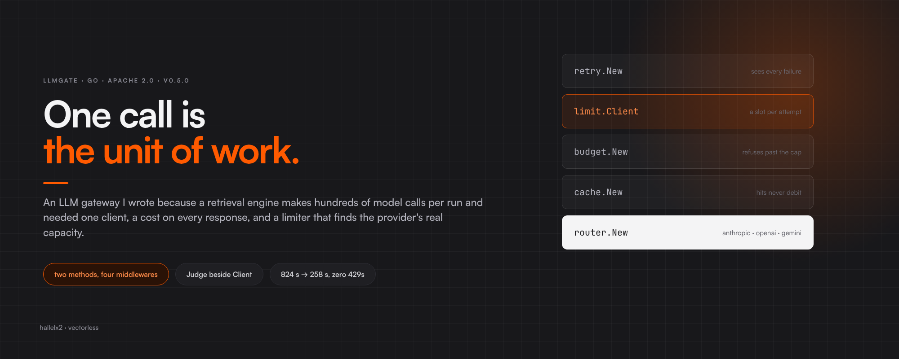
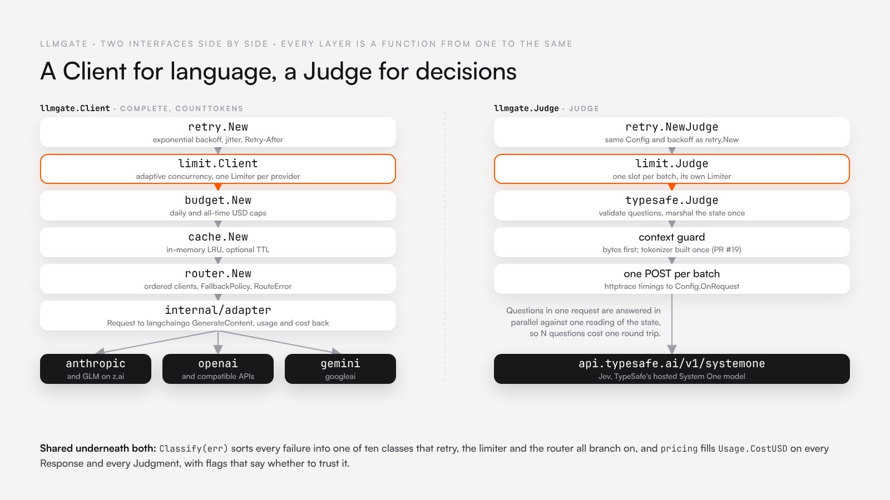
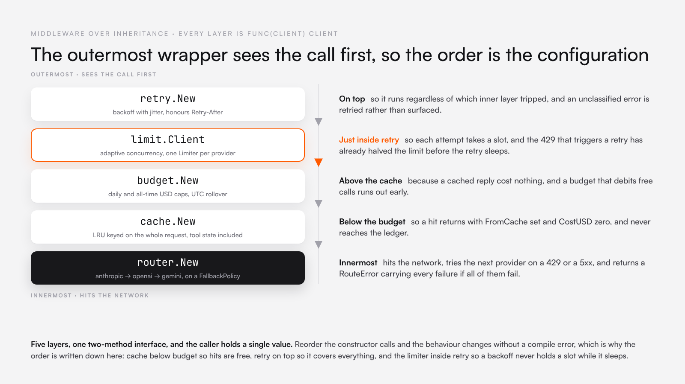
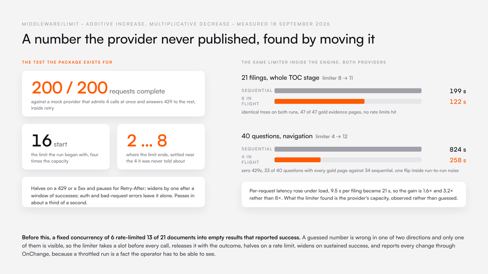
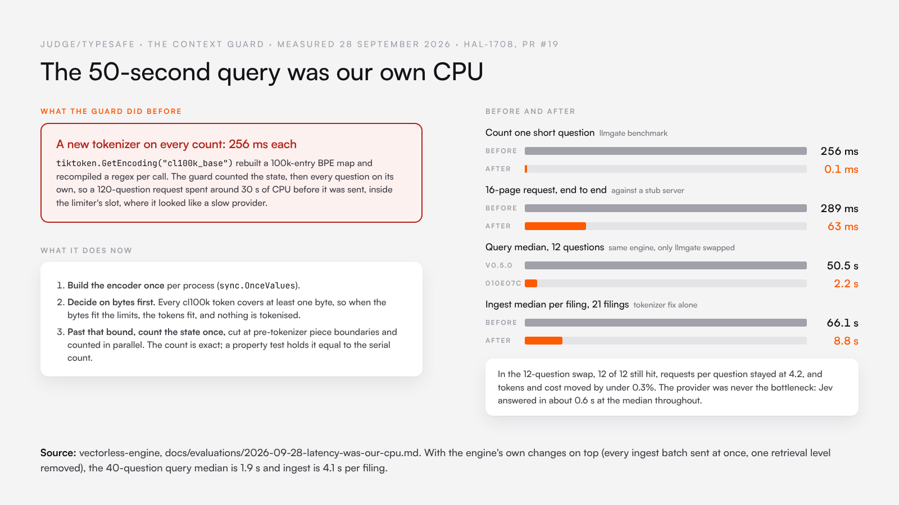
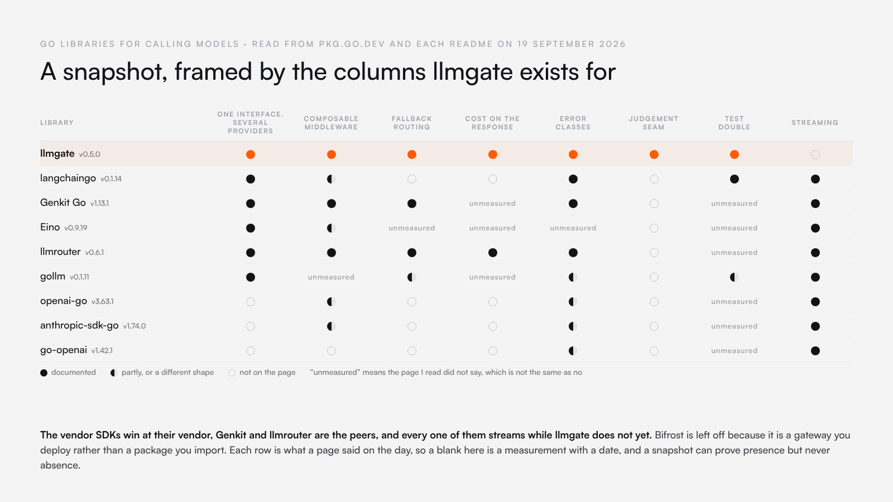

<p align="center">
  
</p>

<p align="center">
  <strong>A provider-agnostic LLM client for Go, in the spirit of LiteLLM.</strong><br/>
  One <code>Client</code> over Anthropic, OpenAI and Gemini with retry, fallback, a budget, a cache, an adaptive concurrency limiter and a cost on every response. Beside it, a <code>Judge</code> interface for System One models that return typed decisions instead of text.
</p>

<p align="center">
  <a href="LICENSE"></a>
  <a href="go.mod"></a>
  <a href="https://pkg.go.dev/github.com/hallelx2/llmgate"></a>
  <a href="https://github.com/hallelx2/llmgate/releases/tag/v0.5.0"></a>
  <a href=".lorx/actions/ci.yml"></a>
  
</p>

<p align="center">
  <a href="#status">Status</a> ·
  <a href="#why-it-exists">Why</a> ·
  <a href="#quick-start">Quick start</a> ·
  <a href="#how-it-works">How it works</a> ·
  <a href="#the-judge-interface">Judge</a> ·
  <a href="#measured">Measured</a> ·
  <a href="#where-it-is-used">Where it is used</a> ·
  <a href="#planned-not-done">Planned</a>
</p>

---

## Status

llmgate was built for [Vectorless](https://github.com/hallelx2/vectorless-engine). Vectorless's hosted service has been paused since 12 October 2026, with its data backed up and its infrastructure kept as code so it can come back. llmgate stays open source under Apache 2.0. Development is slow while the service is paused: issues and pull requests are read, but replies may take a while. For anything else, write to halleluyaholudele@gmail.com.

The interface is the stable surface; implementations evolve underneath. The latest tag is `v0.5.0`.

**The context-guard fix is on `main` but not in a tag (checked 2026-10-12).** On `v0.5.0`, the TypeSafe judge's context guard builds a new cl100k tokenizer on every count, about 256 ms each, and counts the state and every question separately. A 120-question request spent around 30 s of CPU before it was sent. [PR #19](https://github.com/hallelx2/llmgate/pull/19) fixes it and was merged on 2026-10-11. Until a tag is cut, depend on `main` (`go get github.com/hallelx2/llmgate@main`). Vectorless's engine pins the fix commit, `v0.5.1-0.20260928015141-010e07c576e6`. The fix and its measurements are under [The context guard and its fix](#the-context-guard-and-its-fix).

## Why it exists

A product that once made one model call per user action now makes dozens behind a single button. Each is a network request to a company whose rate limits are unpublished, whose prices change, and whose error messages are prose. A database query gets a pool, a retry policy, a timeout and metrics. The model call, which is slower, more expensive and less reliable, usually gets a vendor SDK and a retry loop written again in every service.

llmgate came out of [vectorless-engine](https://github.com/hallelx2/vectorless-engine), a retrieval engine that makes a model call the unit of retrieval work. Ingesting one SEC filing means calls to find the contents page, place each section on a page, and split long sections. Answering one question means calls to rank sections and pages, then one to write the answer. An evaluation run is hundreds of calls across more than one provider, and the cost has to be known per document. So on 2026-04-19, the day the engine was scaffolded, this module was scaffolded beside it: one client surface over three vendors, with retry, fallback, a budget, a cache, a cost on every response, and errors a program can branch on.

The Go options at the time sat at two ends. Vendor SDKs (`openai-go`, `anthropic-sdk-go`) have excellent typing and no portability. Thin wrappers are portable and leave out cost, retries, fallback and capability flags. llmgate is the layer between: one interface, every provider behind it, and the production concerns as composable middleware. It does not reimplement wire protocols. [`tmc/langchaingo`](https://github.com/tmc/langchaingo) speaks each provider's API; llmgate wraps it behind a two-method interface and adds what langchaingo leaves out.

## Quick start

```bash
go get github.com/hallelx2/llmgate
```

```go
package main

import (
	"context"
	"fmt"
	"os"

	"github.com/hallelx2/llmgate"
	"github.com/hallelx2/llmgate/middleware/retry"
	"github.com/hallelx2/llmgate/provider/anthropic"
)

func main() {
	client, err := anthropic.New(anthropic.Config{
		APIKey: os.Getenv("ANTHROPIC_API_KEY"),
		Model:  "claude-sonnet-4-5",
	})
	if err != nil {
		panic(err)
	}

	// Exponential backoff with jitter on transient errors and 429s.
	client = retry.New(retry.Config{MaxRetries: 3})(client)

	resp, err := client.Complete(context.Background(), llmgate.Request{
		Messages: []llmgate.Message{
			{Role: llmgate.RoleUser, Content: "In one sentence: what is vectorless retrieval?"},
		},
		MaxTokens: 256,
	})
	if err != nil {
		panic(err)
	}

	fmt.Println(resp.Content)
	fmt.Printf("%d in, %d out, $%.6f (priced: %v)\n",
		resp.Usage.InputTokens, resp.Usage.OutputTokens, resp.Usage.CostUSD, resp.Usage.Priced)
}
```

Two runnable programs live in [`examples/`](./examples): [`smoke`](./examples/smoke) calls Gemini through retry and prints usage and capabilities, and [`judge`](./examples/judge) asks Jev four questions about one support ticket in one request.

## How it works

<p align="center">
  
</p>

There are two interfaces. `Client` is for work that must produce language. `Judge` is for work that must produce a decision. Every production concern is a function from one of them to the same type, so a caller composes the behaviour it wants and still holds a single value. Underneath both, `Classify` sorts failures into the classes that retry, the limiter and the router branch on, and `pricing` fills `Usage.CostUSD`.

### The Client interface

```go
type Client interface {
	Complete(ctx context.Context, req Request) (*Response, error)
	CountTokens(ctx context.Context, text string) (int, error)
}

type Middleware func(Client) Client
```

That is the whole contract. If a feature does not fit in those two methods, it goes in a middleware rather than the interface.

`Request` carries `Model` (empty means the provider's configured default), `Messages`, `MaxTokens`, the sampling knobs, JSON mode, and tools. `Temperature`, `TopP` and `Seed` are pointers, because a temperature of zero has to be distinguishable from an unset one: provider defaults sit around 1.0, so dropping a zero silently would undo the request for determinism. Use `llmgate.Float64(0)` and `llmgate.Int(42)` to set them inline.

`Response` carries `Content`, `ReasoningContent` (thinking traces, when the provider separates them), `FinishReason`, `ToolCalls`, `Model`, `FromCache`, and a `Usage` block described under [Cost tracking](#cost-tracking-and-pricing).

`CountTokens` is an estimate: tiktoken's encoding for the model, then `cl100k_base`, then a quarter of the character count. It is close, and it is not what the provider bills.

### Providers

The three langchaingo-backed provider packages are between 53 and 65 lines each. Each builds a langchaingo model and hands it to `internal/adapter`, the one place where llmgate's `Request` becomes a langchaingo `GenerateContent` call and the reply becomes a `Response`. `provider/vertex` is the exception: it speaks the Vertex REST API itself.

| Package | Default model | `BaseURL` | Notes |
|---|---|---|---|
| `provider/anthropic` | `claude-sonnet-4-5` | yes | `EnablePromptCache` caches the first user message ([prompt caching](#prompt-caching)) |
| `provider/openai` | `gpt-4o-mini` | yes | Any OpenAI-compatible API: Azure OpenAI, LM Studio, Ollama's OpenAI endpoint |
| `provider/gemini` | `gemini-2.5-flash` | no | Authenticates in `New`, bounded by `AuthTimeout` (default 30 s) so construction cannot hang |
| `provider/vertex` | `gemini-2.5-flash-lite` | tests only | Gemini on Google Cloud Vertex AI over REST, not langchaingo. See [Gemini on Vertex AI](#gemini-on-vertex-ai) |

Every `Config` also has a `ReasoningModel` field. It is stored and not wired to anything; pass `Request.Model` to change model per call.

#### Gemini on Vertex AI

`provider/vertex` calls Gemini through a Google Cloud project, so usage bills to that project and to any credits on its billing account. It talks to the Vertex REST API directly because three things it needs are out of the adapter's reach:

- **Credentials** are Application Default Credentials: a VM's service account, or `gcloud auth application-default login`. `GOOGLE_OAUTH_ACCESS_TOKEN` (a token from `gcloud auth print-access-token`) also works for short sessions. `x-goog-user-project` bills the configured project even when the credentials belong to another.
- **Thinking** is set per client with `Thinking{Budget: llmgate.Int(0)}` or `Thinking{Level: "low"}`. Gemini 3 bills thinking as output. Not every model can stop: on 2026-10-16 `gemini-3.8-flash` still spent 56 thinking tokens on "17*23" with a budget of 0, while both Flash-Lites spent none.
- **`CountTokens`** calls Vertex's `countTokens` endpoint, so the count is the model's own, not a local tokenizer's estimate.
- **Usage** comes from `usageMetadata` in full: cached prompt tokens become `CacheReadTokens`, thought tokens are counted in `OutputTokens` and reported as `ReasoningTokens`, and the cost comes from the price book (with the 10% regional uplift Gemini 3 carries off the `global` endpoint).

```go
c, err := vertex.New(ctx, vertex.Config{
	Project:  "my-project",            // or GOOGLE_CLOUD_PROJECT
	Location: "global",                // or a region such as us-central1
	Model:    "gemini-2.5-flash-lite",
	Thinking: vertex.Thinking{Budget: llmgate.Int(0)},
})
```

Gemini 3 returns a `thoughtSignature` with each function call and rejects the next turn without it. `ToolCall` has no field for it, so the signature travels inside `ToolCall.ID`; echo IDs back unchanged, as a tool loop already does, and the round trip works.

#### Anthropic-compatible gateways and the base URL rules

Vectorless ran GLM through z.ai's Anthropic-compatible endpoint, using the Anthropic provider with a different base URL:

```go
glm, err := anthropic.New(anthropic.Config{
	APIKey:  os.Getenv("ZAI_API_KEY"),
	Model:   "glm-4.6",
	BaseURL: "https://api.z.ai/api/anthropic/v1",
})
```

The rules, from the code:

- **`BaseURL` must end in the version segment.** The Anthropic client posts to `BaseURL + "/messages"` and the OpenAI client to `BaseURL + "/chat/completions"`. The official defaults are `https://api.anthropic.com/v1` and `https://api.openai.com/v1`.
- **A wrong path often comes back as HTTP 200.** z.ai answers a base URL without `/v1` with `{"code":500,"msg":"404 NOT_FOUND"}` in a 200 body, which arrives as a successful call with no content. The adapter turns that into an `*LLMError` of class `gateway` whose message names the model and the endpoint, and adds a hint when the base URL has no `/vN` segment. Retry does not repeat a `gateway` error, because the same request reproduces it.
- **Pricing follows the model, not the provider.** A GLM model served through the Anthropic protocol still prices as GLM ([model IDs are normalized](#model-ids-are-normalized)).

### Errors are data

Retry, the limiter and the router all decide what to do from one classification, so when a provider changes its wording there is one place to fix.

`llmgate.Classify(err)` returns one of ten classes, in this priority: if the error is or wraps an `*LLMError`, its class is already decided; otherwise the context sentinels; otherwise matching on the message text, which is a fallback because providers rephrase errors between releases.

| Class | Typical cause | Retried by default | Halves the limit | Router falls over (`OnTransient`) |
|---|---|---|---|---|
| `transient` | 5xx, dropped connection, EOF | yes | yes | yes |
| `rate_limited` | 429, quota | yes, honouring `Retry-After` | yes, and pauses for `Retry-After` | yes |
| `timeout` | 408, deadline exceeded | yes | no | yes |
| `unknown` | anything unmatched | yes | no | no |
| `auth` | 401, 403 | no | no | no |
| `bad_request` | 400; 422 from TypeSafe | no | no | no |
| `context_length` | 413, context window exceeded | no | no | no |
| `content` | content-policy refusal | no | no | no |
| `canceled` | `context.Canceled` | no | no | no |
| `gateway` | a proxy or gateway answered instead of the model, often with HTTP 200 | no | no | no |

`IsRateLimited`, `IsTransient` and `IsAuth` are one-liners over `Classify`. `RetryAfter(err)` returns the wait the provider asked for, if it asked.

```go
switch llmgate.Classify(err) {
case llmgate.ErrClassRateLimited:
	if d, ok := llmgate.RetryAfter(err); ok {
		log.Printf("provider asked us to wait %s", d)
	}
case llmgate.ErrClassAuth:
	log.Fatal("bad key: ", err)
case llmgate.ErrClassGateway:
	log.Fatal("check the base URL: ", err)
}
```

### The middleware stack and its order

<p align="center">
  
</p>

The outermost wrapper sees the call first and the innermost hits the network. Go will compile any order, so the order is part of the configuration:

```go
lim := limit.New(limit.Config{
	Initial: 8,
	Max:     32,
	OnChange: func(e limit.Event) {
		log.Printf("limit %s %d -> %d (paused %s)", e.Cause, e.From, e.To, e.PausedFor)
	},
})

client := retry.New(retry.Config{MaxRetries: 3})( // outermost: sees every failure
	limit.Client(lim)( // each attempt takes a slot
		budget.New(budget.Config{DailyUSD: 20})( // refuses once the cap is hit
			cache.New(cache.Config{TTL: time.Hour})( // below budget: hits are free
				base))))
```

- **Retry on top**, so it runs whichever inner layer failed.
- **The limiter just inside retry**, so each attempt takes a slot, and the 429 that triggers a retry has already narrowed the limit before the retry sleeps. With retry inside the limiter, one call would hold a slot through its whole backoff.
- **The budget above the cache**, so a cache hit never debits it.
- **The router innermost** when it is used, so the layers above see one client.

Every middleware delegates `Capabilities()` to the client it wraps, so wrapping does not lose what the client knows about its model.

### Router and fallback

`router.New` takes an ordered list of clients and a `FallbackPolicy`, a `func(error) bool`. It tries each client in turn until one succeeds or the policy declines to fall over.

- `router.OnTransient` (the default) falls over on rate limits, transient errors and timeouts.
- `router.OnRateLimit` falls over on 429s only.
- A custom policy is any function you write.

The router does not sleep between providers. Backoff is retry's job; keeping them apart lets either be replaced without touching the other. Because the limiter is per provider, give each provider its own `Limiter` under the router and put retry above it:

```go
routed, err := router.New(router.Config{
	Clients: []llmgate.Client{
		limit.Client(limit.New(limit.Config{}))(claude),
		limit.Client(limit.New(limit.Config{}))(gpt),
	},
	Fallback: router.OnTransient,
})
if err != nil {
	return err
}
client := retry.New(retry.Config{MaxRetries: 3})(routed)

resp, err := client.Complete(ctx, req)
var re *router.RouteError
if errors.As(err, &re) {
	// If the primary returned 401 and the fallback 503, the 401 is the one to read.
	log.Printf("all providers failed: primary=%v last=%v", re.Primary(), re.Last())
}
```

When every client fails, the error is a `*RouteError` holding every error in order, with `Primary()` and `Last()`. `CountTokens` and `Capabilities()` always use the first client: a token count should not change with whichever provider happened to be up.

### Retry with backoff

`retry.New` (and `retry.NewJudge`, which shares its config and code) retries with exponential backoff:

- the delay starts at `BaseDelay` (default 500 ms), doubles each attempt, and stops at `MaxDelay` (default 10 s);
- up to half the delay is added as random jitter, so a fleet retrying together does not collide on the same tick;
- when the provider sent `Retry-After`, that wait is used instead, clamped to `MaxDelay` so a hostile or mistaken header cannot park the caller for an hour;
- `MaxRetries` (default 3) counts attempts after the first;
- context cancellation is never retried.

The default predicate retries `transient`, `rate_limited`, `timeout` and `unknown`, and surfaces everything else on the first failure. Retrying `unknown` is deliberate: an error that cannot be classified is more often a new provider format than a permanent fault, and a bounded retry costs less than losing a call that would have worked. Supply `RetryIf` to change that. The backoff guards against two panics found in testing: `base << attempt` overflowing into a negative duration, and a sub-2 ns base delay reaching `rand.Int63n` with a non-positive bound.

### Budget

`budget.New` refuses calls once a daily (UTC) or all-time USD cap is reached, returning `budget.ErrExceeded`.

- Spend is debited from `Usage.CostUSD` after each successful call. The cap is checked before each call, so one call can push the counters past the cap and the next is refused.
- Estimated costs count. An approximation tracks a budget far better than a zero.
- An unpriced model debits nothing, so a budget over unpriced models never trips. Set `RefuseUnpriced: true` when the cap is a real spending limit; an unpriced call then returns `budget.ErrUnpriced`.
- The daily counter resets at UTC midnight.

To enforce one budget across several clients and inspect it, share a `Ledger`:

```go
ledger := budget.NewLedger(budget.Config{DailyUSD: 20, TotalUSD: 500, RefuseUnpriced: true})
spend := budget.NewWithLedger(ledger)

claude = spend(claude)
gpt = spend(gpt)

daily, total := ledger.Remaining() // math.Inf(1) for a cap that is not set
log.Printf("headroom today $%.2f, overall $%.2f", daily, total)
```

### Cache

`cache.New` is an in-memory LRU (`Capacity`, default 256 entries) with an optional `TTL`.

- The key is a SHA-256 over every request field that can change the answer: model, every message's role, content, tool-call ID and tool calls, `MaxTokens`, the sampling knobs with a presence byte so unset and zero differ, JSON mode and schema, tools and `ToolChoice`.
- Tool state is in the key because during a tool loop the assistant turn that requests a call often has empty content. Hashing only role and content made two different loop states collide, and the second call got the first one's answer.
- A hit returns a deep copy with `FromCache: true` and `Usage.CostUSD` set to zero. Errors and token counts are never cached.

This cache stores whole responses in your process. It is separate from provider-side [prompt caching](#prompt-caching), which bills a repeated prompt prefix at a discount.

### The adaptive concurrency limiter

<p align="center">
  
</p>

No provider documents its concurrency limit, so every service picks a number. Guess high and the provider answers 429, which unless every caller handles it is a request lost. Guess low and the run waits on a semaphore that could have been wider. On 2026-09-18 Vectorless measured both: a chat provider at a fixed concurrency of 6 rate-limited 13 of 21 documents into empty results that reported success, and a System One provider under moderate load failed 3 of 40 batches after four minutes of retries.

`middleware/limit` moves the number instead of fixing it, with additive increase and multiplicative decrease, the way TCP finds a link's capacity:

- a slot is taken before every call and released with the call's outcome;
- a `rate_limited` or `transient` error multiplies the limit by `Decrease` (default 0.5), never below `Min`; if the provider sent `Retry-After`, new calls pause until it passes;
- `SuccessWindow` consecutive successes (default 20) widen the limit by one, never above `Max`;
- auth, bad-request, context-length and cancellation errors leave the limit alone and reset the success streak.

Defaults: `Initial` 4, `Min` 1, `Max` 64. One `Limiter` is shared per provider across every caller that talks to it, so all of them see one number. `limit.Client` takes a slot per `Complete`; `limit.Judge` takes one per batch. `CountTokens` is local and takes none. Every change is reported through `OnChange` as an `Event` (`Cause`, `From`, `To`, `PausedFor`, `Err`), and `Stats()` gives a snapshot (limit, in flight, waiting, increases, decreases, pause) for a dashboard.

The package's main test runs 200 requests, inside retry, against a mock provider that admits four calls at once and answers 429 to the rest, starting from a limit of 16. All 200 complete, the provider serves exactly 200, and the limit ends between 2 and 8. Wired into the engine on 2026-09-18 ([vectorless-engine PR #65](https://github.com/hallelx2/vectorless-engine/pull/65)), with no rate limits hit:

| Run | Sequential | With the limiter | Limit moved |
|---|---|---|---|
| Contents stage, 21 filings | 199 s | 122 s at 8 in flight; identical trees, 47/47 gold pages | 8 → 11 |
| Navigation, 40 questions | 824 s | 258 s at 4 in flight | 4 → 12 |

The gain is 1.6x and 3.2x rather than 8x because per-request latency rises under load (9.5 s per filing became 21 s). What the limiter found is the provider's actual capacity, observed rather than guessed.

### Cost tracking and pricing

Every `Response` (and every `Judgment`) carries a `Usage` computed from a price table, with no extra call:

```go
resp.Usage.InputTokens      // uncached prompt tokens
resp.Usage.CacheWriteTokens // written to the prompt cache (1.25x input on Anthropic)
resp.Usage.CacheReadTokens  // served from the cache (0.1x Anthropic, 0.5x OpenAI, 0.25x Google)
resp.Usage.OutputTokens     // everything generated
resp.Usage.ReasoningTokens  // thinking tokens, a subset of OutputTokens
resp.Usage.TotalTokens
resp.Usage.CostUSD
```

The providers disagree about whether cached tokens are inside the prompt total. Anthropic reports them alongside it; OpenAI and Google report them within it. The adapter normalizes to the disjoint form, so `InputTokens + CacheWriteTokens + CacheReadTokens` is the whole prompt on every provider and the fields can be added without double counting.

Three flags say how far to trust the number:

| Flag | Meaning |
|---|---|
| `Priced` | false: no price-book entry, so `CostUSD` is **unknown**, not zero |
| `TokensReported` | false: the provider returned no counts |
| `Estimated` | true: the counts came from a local tokenizer because the provider reported none, so the cost is approximate |

A `CostUSD` of 0 with `Priced` true asserts that the call was free, which it never is. When a provider reports no usage, llmgate estimates and flags it rather than reporting zero. To be told when a model has no price, set `pricing.WarnFunc`; it is called once per model.

#### Model IDs are normalized

Lookups resolve dated, prefixed and gateway-qualified IDs to the base model, so none of these price at $0:

```
claude-sonnet-4-5-20250929        -> claude-sonnet-4-5
models/gemini-2.5-flash           -> gemini-2.5-flash
us.anthropic.claude-opus-4-1-v1:0 -> claude-opus-4-1
z-ai/glm-4.6                      -> glm-4.6
```

`pricing.Canonical` strips prefixes, dates and revisions, then falls back to the longest matching prefix in the table. Longest, because `claude-sonnet-4` also prefixes `claude-sonnet-4-5-preview` and the shorter key would misprice it. Rates are keyed by model ID alone, never by provider.

#### Where the rates come from

Resolution order is `pricing.Register` overrides, then a remote snapshot if you opted in, then the hand-maintained Gemini table, then the embedded table, then the hand-maintained System One table.

- **The embedded table** (`pricing/defaults_gen.go`) is generated from LiteLLM's public price feed by `go generate ./pricing`. The current one was fetched 2026-08-02; `pricing.DefaultsAsOf()` reports that date. When the same model appears from several resellers, the vendor that made it wins.
- **Live prices are opt-in.** No vendor publishes machine-readable pricing, so `UseRemote` layers a community aggregate over the embedded table: [LiteLLM's price table](https://github.com/BerriAI/litellm/blob/main/model_prices_and_context_window.json), then [OpenRouter's model API](https://openrouter.ai/api/v1/models). Importing `pricing` performs no network I/O.

```go
stop, err := pricing.UseRemote(ctx, pricing.RemoteConfig{
	CacheDir: "/var/cache/llmgate", // restarts start warm
	OnError:  func(src string, err error) { log.Printf("price refresh from %s: %v", src, err) },
})
if err != nil {
	return err
}
defer stop()

asOf, source := pricing.AsOf() // vintage of the loaded snapshot
```

It refreshes every 24 hours by default and fails open at every layer: lookups never wait on the network, a failed fetch keeps the previous snapshot, and a snapshot whose rates moved more than 10x from the embedded values is rejected as a units error rather than adopted.

- **Gemini models newer than the embedded table** are priced in `pricing/google.go`, by hand from Google's Vertex price list (read 2026-10-16). It is consulted before the embedded table, so `gemini-2.5-flash-lite` no longer resolves by prefix to `gemini-2.5-flash` at three times its input rate. Gemini 3.6–3.8 Flash are recorded at their $1.50 / $7.50 list price; the introductory 50% credit-back through 2026-12-31 arrives on a later invoice and is not a lower rate.
- **System One models** are priced in `pricing/systemone.go`, by hand, because the feeds index only chat-completion models and a generated entry would be wiped by the next `go generate`. It is consulted last, so a feed or `Register` still wins.

```go
pricing.Register("my-finetune", pricing.Price{InputPerMTok: 1.0, OutputPerMTok: 4.0})
p, ok := pricing.Lookup("claude-sonnet-4-5-20250929") // resolves to claude-sonnet-4-5
```

### Prompt caching

A workload that resends a large stable prefix on every call (a document, a schema, a long brief) can have the provider cache it. Anthropic bills a cache read at a tenth of the input rate. Mark the last message of the stable prefix with `CacheBreakpoint`:

```go
resp, err := client.Complete(ctx, llmgate.Request{
	Messages: []llmgate.Message{
		{Role: llmgate.RoleUser, Content: filingText, CacheBreakpoint: true},
		{Role: llmgate.RoleUser, Content: question},
	},
	MaxTokens: 512,
})
log.Printf("cache write %d, cache read %d", resp.Usage.CacheWriteTokens, resp.Usage.CacheReadTokens)
```

`anthropic.Config{EnablePromptCache: true}` is shorthand for marking the first user message; an explicit breakpoint anywhere in the request turns the shorthand off. The marker only goes on user turns, because langchaingo's Anthropic system-message handler rejects cache-marked content and the request would fail. Providers without prompt caching ignore the marker. Below the provider's minimum cacheable length (1,024 tokens on most Anthropic models) it does nothing. Cache writes and reads are metered into `Usage` and priced.

### Tool calling

`Request.Tools` declares tools with a JSON Schema; the model's calls come back on `Response.ToolCalls`. Echo the calls back on an assistant message and answer each with a `RoleTool` message carrying its `ToolCallID`:

```go
req := llmgate.Request{
	Messages: []llmgate.Message{{Role: llmgate.RoleUser, Content: "What is on page 39?"}},
	Tools: []llmgate.ToolDef{{
		Name:        "get_page",
		Description: "Return the text of one page of the filing.",
		InputSchema: []byte(`{"type":"object","properties":{"n":{"type":"integer"}},"required":["n"]}`),
	}},
	ToolChoice: "auto", // or "required", "none", or a tool name to force
}
resp, err := client.Complete(ctx, req)
if err != nil {
	return err
}
req.Messages = append(req.Messages, llmgate.Message{Role: llmgate.RoleAssistant, Content: resp.Content, ToolCalls: resp.ToolCalls})
for _, call := range resp.ToolCalls {
	req.Messages = append(req.Messages, llmgate.Message{
		Role: llmgate.RoleTool, ToolCallID: call.ID, Content: runTool(call.Name, call.Input),
	})
}
resp, err = client.Complete(ctx, req)
```

The adapter folds every content block of a reply into one `Response`. langchaingo returns one choice per Anthropic content block, so a reply of `[thinking, text]` or `[text, tool_use]` used to lose the answer or the tool call when only the first choice was read.

### Capability flags

`capabilities.Of(client)` returns `MaxContext`, `SupportsJSONMode`, `SupportsStreaming`, `SupportsTools` and `SupportsVision` for the client's configured model, from a registry of known models that `capabilities.Register` can extend. They describe the model, not llmgate: `SupportsStreaming` can be true while llmgate itself does not stream yet. The defaults are one guess per model family.

## The Judge interface

Some work does not need language. Routing a ticket, ranking a section, checking whether a quote supports a claim: the output is a decision, and wrapping it in prose only to parse the prose back out is overhead. Before `Judge`, Vectorless got its decisions from a chat model by asking for JSON, parsing it, and retrying when the JSON was wrong.

A **System One model** returns the decision directly. You send a state and a map of named questions; it answers every question, in parallel, with a value whose type you fixed in advance. It has no messages, no roles and no assistant turn, so it does not fit behind `Complete`. Forcing it there would mean encoding questions into a prompt and parsing answers out of text, which brings back the JSON retry loop the typed API removes. So `Judge` sits **beside** `Client`:

```go
type Judge interface {
	Judge(ctx context.Context, req JudgeRequest) (*Judgment, error)
}

type JudgeMiddleware func(Judge) Judge
```

Hold a `Client` for language, a `Judge` for decisions, and both when you need both. Every consumer in vectorless-engine treats a nil `Judge` as judging disabled and falls back to its generative path.

### Noul, Choice and Score

`Question` is a sealed interface: only these three implement it, because the set of primitives is fixed by the model. The transport can switch on them exhaustively, and the mock can build a well-formed answer for any of them.

| Question | Returns | Reach for it when |
|---|---|---|
| `Noul` | the probability of yes | A condition holds or it doesn't. Use one per label when several can apply at once |
| `Choice` | one option, the full distribution, and a confidence | Exactly one outcome wins |
| `Score` | a probability-weighted position on an ordered rubric, the distribution, and a confidence | The answer is a degree |

- `Noul` carries **no confidence**. The probability is the answer. A Noul near 0.5 means yes and no are about equally likely; it does not mean medium intensity.
- `Confidence` on the other two says how concentrated the distribution is. It is not the probability that the answer is correct, and several acceptable options spread probability too, so low confidence on a harmless choice is not a problem.
- Give a `Choice` a no-match option whenever none of the real ones might fit, or the distribution is forced across wrong answers.
- A `Score` can land between levels; 1.6 is a real answer. It is safe to threshold and not safe to read as a measurement.
- Requests are validated locally before sending: no questions (`ErrNoQuestions`), empty instructions, a Choice with fewer than two options or duplicate names, a Score with fewer than two levels (`ErrQuestionInvalid`). The provider would answer those with a 422.
- The accessors return `ErrAnswerMissing` when an ID has no answer and `ErrAnswerType` when it was answered as a different primitive, so a real zero is never confused with a missing answer.
- `Judgment.Model` is the versioned ID that answered. When the request named an alias such as `jev-latest`, log this value: a threshold tuned against one version is not evidence about the next.

```go
j, err := typesafe.New(typesafe.Config{}) // key from TYPESAFE_API_KEY
if err != nil {
	return err
}
jevLimit := limit.New(limit.Config{Initial: 4, Max: 32})
judge := retry.NewJudge(retry.Config{MaxRetries: 3})(limit.Judge(jevLimit)(j))

result, err := judge.Judge(ctx, llmgate.JudgeRequest{
	Model: "jev-1.13.0", // pin a version once thresholds are tuned against it
	State: map[string]any{"ticket": ticket},
	Questions: map[string]llmgate.Question{
		"is_urgent":    llmgate.Noul{Instructions: "Is this time-sensitive?"},
		"wants_refund": llmgate.Noul{Instructions: "Is the customer asking for money back?"},
		"team": llmgate.Choice{
			Instructions: "Which team should own this?",
			Options: llmgate.ChoiceOptions{
				{Name: "billing", Description: "Payments, invoicing, refunds"},
				{Name: "technical", Description: "Bugs, outages, integrations"},
				{Name: "unclear", Description: "Not enough information to route"},
			},
		},
		"frustration": llmgate.Score{
			Instructions: "How frustrated does the customer sound?",
			Levels:       []string{"Neutral", "Annoyed", "Angry", "Threatening to leave"},
		},
	},
})
if err != nil {
	return err
}

urgent, _ := result.Noul("is_urgent")  // probability of yes
team, _ := result.Choice("team")       // .Choice, .Probabilities, .Confidence
mood, _ := result.Score("frustration") // .Score, .Legend, .Probabilities, .Confidence
log.Printf("model %s, urgent %.2f, team %s (%.2f), frustration %.1f, $%.6f",
	result.Model, urgent, team.Choice, team.Confidence, mood.Score, result.Usage.CostUSD)
```

The decision itself belongs to code. The model supplies the judgments; the policy that combines them stays yours to change without re-running anything. [`examples/judge`](./examples/judge) shows that end to end.

### One request, many questions

That example is **one** HTTP call, not four. The model reads the state once and runs every question against it in parallel, so packing a batch is the point and fanning out into a call per question is the habit to drop. Questions in one request cannot see each other's answers, which is what makes them parallel; send a second request only when an answer decides what evidence to fetch next.

Two limits bound a batch: **64k tokens** for the state plus all questions, and **32k** for the state plus the single longest question. The transport checks both before sending (below), so an oversized batch fails with `context_length` and costs nothing. `MockJudge.SimulateContextLimit()` exercises that path in tests.

Keep the state to what the questions need. TypeSafe publishes a [jaggedness page](https://docs.typesafe.ai/model-jaggedness/jev-1.13) for Jev; the three that bite hardest:

- **It is not a calculator.** Counting, arithmetic and date ordering are unreliable; it reads dates as text. Keep them in code. Extraction is a judgment; comparison is not.
- **It reads literally.** It answers the question you wrote. A `Noul` whose `Criteria.True` describes the no case measurably underperforms.
- **Context rot.** Accuracy falls as the state grows with material unrelated to the decision.

It does not generate text. When the answer space is bounded, turn extraction into a `Choice` over candidates your code found.

### The context guard and its fix

<p align="center">
  
</p>

TypeSafe does not publish Jev's tokenizer, so the guard estimates with `cl100k_base`. It is an early warning, not an authority: the server rules on the real count, and `Config.SkipContextGuard` turns the guard off if it ever rejects a request the API would accept.

On `v0.5.0` the guard called `tiktoken.GetEncoding("cl100k_base")` on every count. tiktoken-go v0.1.6 caches the rank table but builds a new BPE on each call, a 100k-entry map and a regex compile, which measured 256 ms. The guard counted the state and then each question separately, so the 120-question section ranking in Vectorless spent around 30 s of CPU before it went on the wire, inside the limiter's slot, where it looked like a slow provider.

[PR #19](https://github.com/hallelx2/llmgate/pull/19) (HAL-1708, merged 2026-10-11):

1. builds the encoder once per process;
2. decides on byte length first: every cl100k token covers at least one byte, so when the bytes fit both limits, the tokens fit, and nothing is tokenised;
3. past that bound, counts the state once, cut at pre-tokenizer piece boundaries and counted in parallel. The count is exact; a property test holds it equal to the serial count on 61 texts, including multilingual text;
4. marshals the state once and embeds it in the body;
5. adds `Config.OnRequest`, which reports each call's prepare time, whether the guard tokenised, connect time, connection reuse, time to first byte, total, status and tokens;
6. adds `Judge.Warm`, which opens a connection and builds the tokenizer before the first call.

Measured on 2026-09-28 ([vectorless-engine report](https://github.com/hallelx2/vectorless-engine/blob/main/docs/evaluations/2026-09-28-latency-was-our-cpu.md)):

| | Before | After |
|---|---|---|
| Count one short question (llmgate benchmark) | 256 ms | 0.1 ms |
| 16-page request, end to end against a stub | 289 ms | 63 ms |
| 120-head skim request, end to end against a stub | 163 ms | 45 ms |
| Query median, first 12 FinanceBench questions, same engine, only llmgate swapped (`v0.5.0` → `010e07c`) | 50.5 s | 2.2 s |
| Ingest median per filing, 21 filings, tokenizer fix alone | 66.1 s | 8.8 s |

In the 12-question swap, all 12 still hit, requests per question stayed at 4.2, and tokens and cost per question moved by under 0.3%. Jev answered in about 0.6 s at the median throughout; the time had gone to the client preparing each request. With the engine's own changes on top (ingest batches sent together, one retrieval level removed), the 40-question query median became 1.9 s and ingest 4.1 s per filing. Reproduce the llmgate half with:

```bash
go test -run XXX -bench . ./judge/typesafe/
```

To see where a Judge call's time goes in your own system:

```go
j, err := typesafe.New(typesafe.Config{
	OnRequest: func(t typesafe.RequestTrace) {
		log.Printf("judge %s q=%d prepare=%s counted=%v connect=%s ttfb=%s total=%s status=%d",
			t.Model, t.Questions, t.Prepare, t.GuardCounted, t.Connect, t.FirstByte, t.Total, t.StatusCode)
	},
})
if err != nil {
	return err
}
_ = j.Warm(ctx) // optional: connection and tokenizer ready before the first call
```

### TypeSafe Jev, a hosted API

The one `Judge` implementation is [TypeSafe](https://docs.typesafe.ai)'s **Jev**, in `judge/typesafe`. Jev is a hosted API: every request sends the state to `api.typesafe.ai`. It lives under `judge/` rather than `provider/` because nothing in it implements `Client`.

Read from [docs.typesafe.ai/models](https://docs.typesafe.ai/models) on 2026-10-12:

| | Jev 1.13 (`jev-1.13.0`) |
|---|---|
| Price | $0.042 per million input tokens; **output tokens are free** |
| Rate limits | 100K tokens per second and 80 requests per second; TypeSafe says these are adjusting and can change without notice |
| Context | 64k tokens per request; 32k for the state plus the longest question |
| Input | text only: a string, a JSON object, or an array of text values |
| Aliases | `jev-latest` and `jev-preview`, both pointing to `jev-1.13.0` |

The same rate and the free output are in `pricing/systemone.go`, read from TypeSafe's docs on 2026-09-17. That zero output rate is a published price, not a gap in the table.

Configuration, from `typesafe.Config`:

- `APIKey`, or `TYPESAFE_API_KEY` when empty. `New` fails without a key rather than waiting for a 401.
- `BaseURL` (default `https://api.typesafe.ai`) and `Model` (default `jev-latest`) are set in code. Reading them from `TYPESAFE_BASE_URL` and `TYPESAFE_MODEL` is [PR #18](https://github.com/hallelx2/llmgate/pull/18), open as of 2026-10-12.
- A plain `http://` base URL is refused unless it is loopback, because every request carries the key as a bearer token.
- `HTTPClient` (default: 60 s timeout), `CountTokens` (replace the estimator), `SkipContextGuard`, `OnRequest`.

The transport maps errors onto the shared classes: 401/403 → `auth`, 422 → `bad_request` (so a validation failure is not retried four times), 429 → `rate_limited` with `Retry-After` read from the header, 5xx including 529 → `transient`, a dropped connection → `transient`. It reads at most 8 MiB of a response. A body that is not JSON, a probability outside [0, 1], a missing field, an answer of the wrong type, or a response that skips or adds a question is classed `gateway`, because each means something other than the API answered.

Live tests sit behind a build tag so a plain `go test ./...` stays offline and free:

```bash
# key from the environment, or from a gitignored .env up the tree
go test -tags live -v -run TestLive ./judge/typesafe/
```

`TestLiveLatencyScaling` is the one to re-run when the model version moves: it holds the state fixed, varies the question count, and fails if 20 questions cost more than five times one.

## Testing without spending money

`go test ./...` runs offline because the root package ships two doubles.

- `llmgate.Mock` records every request, answers with a fixed `Reply` or a `Respond` function, and exposes `Calls()`, `LastPrompts()` and `LastMessages()` so a test can assert on the system prompt and the whole conversation.
- `llmgate.MockJudge` answers from canned `Answers`, a `Respond` function, or a default. The default builds a real distribution summing to 1 for each question, from the question's own shape, so thresholding logic actually runs. It validates requests by default, so a test cannot pass with a question the real transport would refuse.

```go
func TestUrgentTicketsSkipTheQueue(t *testing.T) {
	judge := &llmgate.MockJudge{Answers: map[string]llmgate.Answer{
		"is_urgent": llmgate.NoulAnswer{Noul: 0.92},
	}}
	if got := route(context.Background(), judge, "payouts failing for three days"); got != "priority" {
		t.Fatalf("route = %q, want priority", got)
	}
	req, _ := judge.LastRequest()
	if len(req.Questions) != 1 {
		t.Fatalf("sent %d questions, want 1", len(req.Questions))
	}
}
```

## Measured

Every number in this README with its date and source:

| Claim | Number | Date | Source |
|---|---|---|---|
| Guard tokenizer cost on `v0.5.0` | 256 ms per count; about 30 s of CPU for a 120-question request | 2026-09-28 | [latency-was-our-cpu](https://github.com/hallelx2/vectorless-engine/blob/main/docs/evaluations/2026-09-28-latency-was-our-cpu.md), [PR #19](https://github.com/hallelx2/llmgate/pull/19) |
| Guard fix, llmgate benchmarks | 256 ms → 0.1 ms; 289 → 63 ms; 163 → 45 ms | 2026-09-28 | same |
| Guard fix, engine query median (12 questions, only llmgate swapped) | 50.5 s → 2.2 s | 2026-09-28 | same |
| Engine query median with the engine's own changes too (40 questions) | 50.5 s → 1.9 s, still 36/40 | 2026-09-28 | same |
| Engine ingest median per filing | 66.1 s → 8.8 s (tokenizer fix), → 4.1 s (with batch fan-out) | 2026-09-28 | same |
| Fixed concurrency of 6 | 13 of 21 documents rate-limited into empty results | 2026-09-18 | `middleware/limit` doc comment |
| Limiter in the engine | 199 → 122 s (21 filings); 824 → 258 s (40 questions) | 2026-09-18 | [vectorless-engine PR #65](https://github.com/hallelx2/vectorless-engine/pull/65), figure above |
| Jev price, limits, context | $0.042/M input, output free; 100K tok/s, 80 req/s; 64k / 32k | 2026-10-12 | [docs.typesafe.ai/models](https://docs.typesafe.ai/models) |
| Embedded price table vintage | LiteLLM feed | 2026-08-02 | `pricing/defaults_gen.go` |
| Go ecosystem comparison | see the figure below | 2026-09-19 | pkg.go.dev and each project's README |

## Where it is used

[vectorless-engine](https://github.com/hallelx2/vectorless-engine) is the one production user. It pins `github.com/hallelx2/llmgate v0.5.1-0.20260928015141-010e07c576e6`, the guard-fix commit, which is now on `main`.

- **Ingest.** The contents stage finds the contents page, confirms which entries are real, places each entry on its page, and splits sections longer than 20 pages at their own headings. Every one of those decisions is a `Judge` batch (`pkg/ingest/toc_judge.go`, `toc_resolve.go`, `toc_split.go`); ingest makes no generative call.
- **Navigation.** The `judgewalk` strategy ranks sections, skims page heads and picks pages with Jev (`pkg/retrieval/judgewalk.go`); retrieval makes no generative call. The `treewalk` fallback walks pages with a chat `Client` when no Judge is configured or Jev refuses.
- **Answers and pincites.** A chat `Client` (Anthropic, OpenAI, Gemini, or GLM on z.ai through the Anthropic provider) writes the answer. For each claim, Jev picks one quote from a shortlist of the page's own sentences in a single batched `Choice` call (`pkg/pincite/choose.go`), and the citation falls back to page level below 0.35 confidence.
- **Plumbing.** `cmd/server` wraps the chat client in `limit.Client` and the Judge in `retry.NewJudge(limit.Judge(...))`, each with its own `Limiter` and every change logged.

The engine's figures that depend on this library (40/40 right section on FinanceBench, $0.0003 to $0.0015 per filing for the contents stage) are in its [evaluations](https://github.com/hallelx2/vectorless-engine/tree/main/docs/evaluations).

## Where it sits in Go

<p align="center">
  
</p>

A snapshot read from pkg.go.dev and each project's README on 2026-09-19. The columns are the things llmgate exists for, so the table is framed in its favour, and "unmeasured" means the page did not say. The vendor SDKs are better at their own vendor than llmgate will be; if you only call one provider, use one. Genkit Go has composable Retry and Fallback middleware and streaming. llmrouter is the closest peer, with the same `func(Provider) Provider` composition, a circuit breaker and streaming. Every library in the table streams; llmgate does not yet.

## Planned, not done

- **Streaming.** `Streamer` is declared and no provider implements it. The shape of the work is in [ROADMAP.md](./ROADMAP.md): adapt langchaingo's streaming callback into a chunk sequence; the cache replays a hit as one chunk, retry retries only before the first chunk, the budget debits on completion.
- **Native `CountTokens`** through each provider's counting endpoint, keeping the estimate as the fallback.
- **Caching a system prompt, and OpenAI strict structured outputs.** Both need a native client rather than the langchaingo path: langchaingo's Anthropic system handler rejects cache-marked content, and it does not send `strict: true`. Prompt caching on user messages works today.
- **`ReasoningModel`** is carried on every provider config and unused.
- **Per-provider capability defaults**, instead of one guess per model family.
- **A tag containing the guard fix.** `v0.5.0` is the latest tag and predates it.

## Design principles

- **The interface is tiny.** `Complete` and `CountTokens`. If a feature does not fit, it goes in a middleware.
- **A second interface beats a leaky first one.** When a model's shape differs, add a seam; do not widen the existing one until it fits everything and describes nothing.
- **Middleware over inheritance.** Retries, limits, caching, budgets: all `func(Client) Client`. The order they compose in is the configuration.
- **Errors are data.** Ten classes that every other piece branches on, with string matching kept as the fallback.
- **Cost on every response,** with flags that say how much to trust it.
- **No magic config.** Pass a struct, get a client.
- **Every claim about a provider carries the date it was measured,** because a provider is a system you do not control.

## Contact and license

Open source under Apache 2.0. Write to halleluyaholudele@gmail.com.

Apache 2.0. See [LICENSE](./LICENSE) and [NOTICE](./NOTICE).
